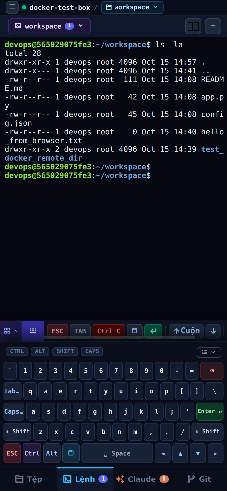
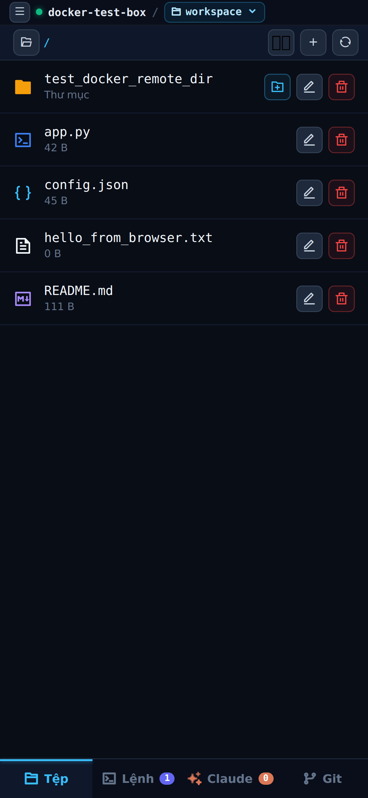
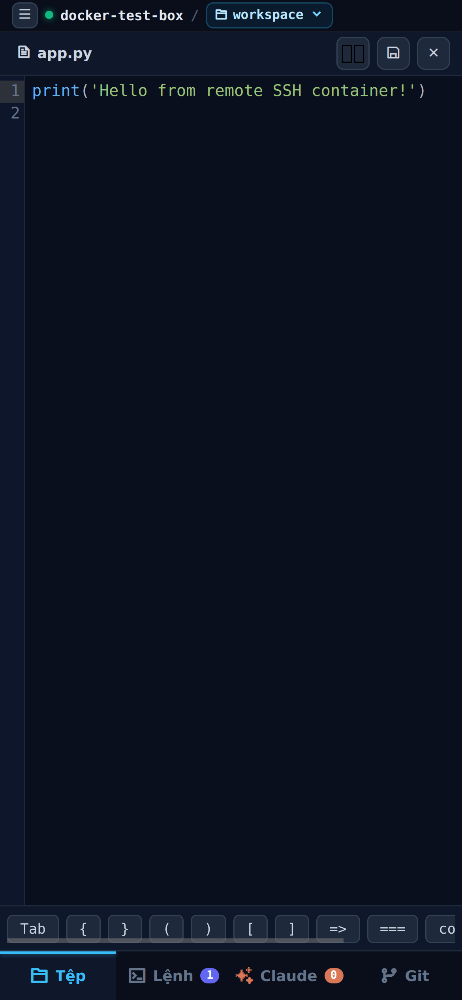
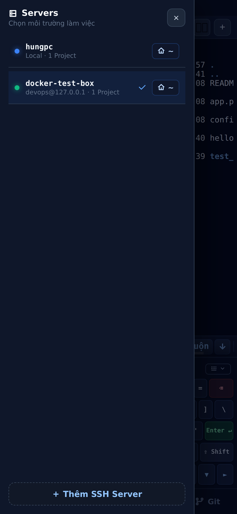
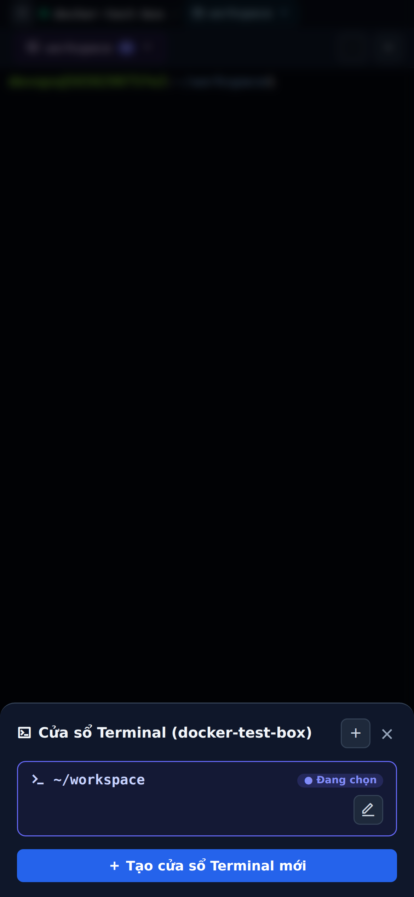
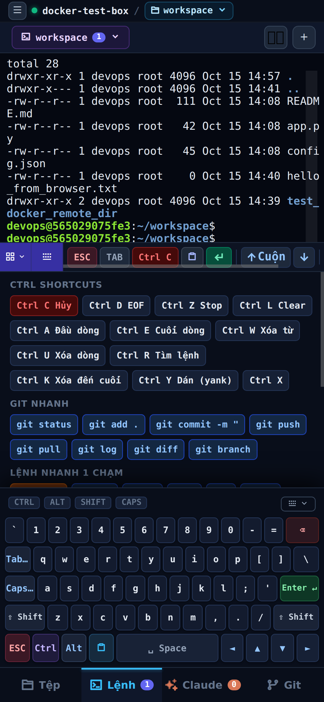
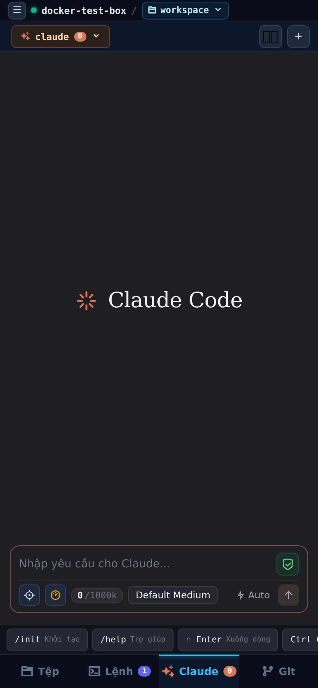
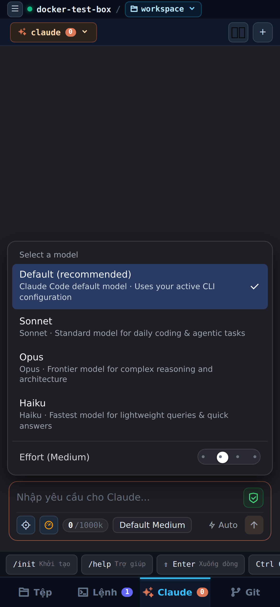

# 🐴 HugRemote — Mobile-First Web IDE & Terminal

> **Mobile-first web IDE, multi-window terminal, and Claude Code coding assistant crafted for smartphones, remote servers, and Docker containers.**

[](https://github.com/vibecoding-hungkc/hugremote/releases)
[](LICENSE)
[]()
[-purple.svg)]()

---

## 📱 Mobile-First Experience (Showcase on Remote Docker Container)

HugRemote được thiết kế ưu tiên 100% cho màn hình di động, mang lại trải nghiệm lập trình, biên tập code và quản trị container mượt mà ngay trên điện thoại:

<p align="center">
  
  &nbsp;&nbsp;
  
  &nbsp;&nbsp;
  
</p>

<p align="center">
  <em>Hình 1: Terminal với Bàn phím ảo Laptop (trái) · Duyệt file Docker Container qua SFTP (giữa) · Soạn thảo Code trực tiếp trên Mobile (phải)</em>
</p>

### 🎯 Tính năng cốt lõi trên Mobile

| Tính năng | Chi tiết |
|---|---|
| **⌨️ Bàn phím ảo Laptop (ANSI 5 hàng)** | Bố cục chuẩn laptop với đầy đủ hàng số, ký tự đặc biệt (`~`, `@`, `#`), phím điều hướng và các modifier dính thông minh (`Ctrl`, `Alt`, `Shift`, `Caps`). Khắc phục triệt để lỗi bàn phím hệ điều hành nhảy lên che màn hình. |
| **🐳 Thao tác File Remote Container qua SFTP** | Duyệt cây thư mục, tạo mới tệp/folder, chỉnh sửa code, đổi tên và xóa đệ quy trực tiếp trên Docker container hoặc SSH VPS từ xa mà không cần cài agent. |
| **🧭 Header 2 tầng tối ưu diện tích** | Tầng 1 (28px): Menu + Server + Project selector có icon dropdown; Tầng 2 (38px): Session Pill co giãn thông minh hiển thị cấp cuối thư mục, triệt tiêu 100% hiện tượng tràn viền (0px overflow). |
| **⚡ Thanh phím tắt & Drawer 1 chạm** | Nút Dán nhanh (Bracketed Paste) nằm liền kề Ctrl+C; Drawer mở rộng tích hợp sẵn cụm lệnh Git Nhanh và Lệnh Nhanh 1 Chạm thường dùng. |
| **🧹 Tự động dọn dẹp Session (Chống tràn 50)** | Cơ chế background sweeper tự động terminate các session idle quá 30 phút và cơ chế LRU eviction tự giải phóng session rác cũ khi đầy bộ nhớ. |

---

## 🎛️ Quản lý Đa Server & Đa Phiên trên Mobile

<p align="center">
  
  &nbsp;&nbsp;
  
  &nbsp;&nbsp;
  
</p>

<p align="center">
  <em>Hình 2: Menu chọn Multi-Server SSH & Container (trái) · Hub quản lý đa phiên Terminal (giữa) · Drawer phím tắt lệnh 1 chạm (phải)</em>
</p>

---

## 🤖 Trợ lý Lập trình Claude Code trên Mobile

<p align="center">
  
  &nbsp;&nbsp;
  
</p>

<p align="center">
  <em>Hình 3: Trợ lý Claude Code thời gian thực trên mobile (trái) · Popup chọn Model Claude động theo máy chủ (phải)</em>
</p>

* **Dynamic Model Discovery:** Tự động phát hiện và nạp danh sách model Claude động từ cấu hình máy chủ hoặc qua CLI (`claude -p /model`).
* **Tool Invocation Cards:** Hiển thị trực quan các lệnh bash, file read/edit của Claude Code dưới dạng thẻ thao tác gọn gàng.
* **Theo dõi hạn mức & Token:** Popup kiểm tra hạn mức sử dụng 5 giờ và tuần, tính toán chi phí token trực quan.

---

## ⚡ Quick Install

**Bản Stable Release (v1.3.0):**
```bash
curl -fsSL https://raw.githubusercontent.com/vibecoding-hungkc/hugremote/main/install.sh | bash
```

**Bản Beta / Latest Main Branch (Cập nhật tính năng mới nhất):**
```bash
curl -fsSL https://raw.githubusercontent.com/vibecoding-hungkc/hugremote/main/beta.sh | bash
```

Hoặc chạy nhanh qua `npx`:
```bash
npx hugremote
```

---

## 🚀 CLI Usage, Cập nhật & Cấu hình Reverse Proxy

```bash
# Xem phiên bản hiện tại
hugremote --version

# Cập nhật mã nguồn mới nhất & tự động build lại
hugremote update

# Ép buộc kéo mã nguồn và biên dịch lại ngay cả khi đã ở commit mới nhất
hugremote update --force

# Mặc định: cổng 8099, không yêu cầu xác thực
hugremote

# Chạy với subpath tiền tố cho Cloudflare Tunnel hoặc Nginx reverse proxy
hugremote -p 8099 -b /remote

# Xác thực bằng mật khẩu
hugremote --auth password --password 'your-password'

# Xác thực bằng tài khoản Google (OAuth 2.0)
AUTH_MODE=google \
APP_URL=https://your-domain.com \
BASE_PATH=/remote \
GOOGLE_CLIENT_ID=... \
GOOGLE_CLIENT_SECRET=... \
GOOGLE_ALLOWED_EMAILS=user@gmail.com,admin@domain.com \
hugremote
```

### File cấu hình lưu trữ (`.env`)

HugRemote tự động nạp file cấu hình chuẩn tại:
```bash
~/.config/hugremote/.env
```

Ví dụ cấu hình chạy ngầm qua đường dẫn Cloudflare Tunnel `https://your-domain.com/remote/`:
```env
PORT=8099
HOST=127.0.0.1
BASE_PATH=/remote
AUTH_MODE=none
```

Sau khi sửa file cấu hình, khởi động lại dịch vụ:
```bash
systemctl --user restart hugremote
```

### Bảng tùy chọn CLI

| Tham số / Lệnh | Mô tả | Mặc định |
|---|---|---|
| `update` | Cập nhật HugRemote lên commit mới nhất & build lại | |
| `-v, --version` | Xem phiên bản hiện tại | `1.1.1` |
| `-p, --port <number>` | Cổng HTTP & WebSocket | `8099` hoặc `$PORT` |
| `-h, --host <ip>` | Địa chỉ IP lắng nghe | `::` hoặc `$HOST` |
| `-b, --base-path <path>` | Tiền tố đường dẫn subpath (vd: `/remote`) | `""` hoặc `$BASE_PATH` |
| `-w, --workspace <dir>` | Thư mục workspace mặc định | `~/projects` hoặc `$WORKSPACE_ROOT` |
| `-a, --allowed-root <dir>` | Thư mục giới hạn tối đa cho duyệt file | `~` hoặc `$ALLOWED_ROOT` |
| `--auth <mode>` | Chế độ xác thực: `none`, `password`, `google` | `none` hoặc `$AUTH_MODE` |
| `--password <pass>` | Mật khẩu ban đầu (mặc định: `123456`, bắt buộc đổi lần đầu) | `123456` |
| `--app-url <url>` | Public app URL phục vụ callback Google OAuth | `http://localhost:8099` |
| `--help` | Xem hướng dẫn câu lệnh | |

---

## 🔐 Các Chế Độ Xác Thực

### 1. No Auth (`none`)
Thích hợp khi chạy trên mạng nội bộ (LAN) hoặc khi đã có lớp bảo vệ bên ngoài như **Cloudflare Access / Zero Trust**.

### 2. Password Auth
* Mật khẩu khởi tạo ban đầu là `123456`.
* Hệ thống bắt buộc đổi mật khẩu ở lần đăng nhập đầu tiên.
* Mật khẩu được băm bằng PBKDF2-SHA512 (100.000 vòng) kèm Salt 32-byte an toàn lưu tại `~/.config/hugremote/auth.json`.
* Chống Brute-force: Tự động khóa 15 phút nếu nhập sai quá 5 lần liên tiếp.

### 3. Google OAuth 2.0
* Giới hạn quyền truy cập chỉ cho các email có trong danh sách `GOOGLE_ALLOWED_EMAILS`.
* Redirect URI tương thích hoàn toàn khi chạy qua `BASE_PATH`: `${APP_URL}${BASE_PATH}/auth/google/callback`.

---

## 🤖 Điều khiển qua Telegram Bot (Sidecar)

HugRemote tích hợp sẵn Telegram Bot điều khiển Claude Code và Terminal từ xa:

1. Thêm cấu hình vào `~/.config/hugremote/.env`:
   ```env
   TELEGRAM_BOT_TOKEN=123456789:ABCdefGHIjklMNOpqrsTUVwxyz
   TELEGRAM_ALLOWED_USERS=123456789,my_username
   TELEGRAM_TOPIC_MODE=true
   ```
2. Các lệnh điều khiển chính:
   * `/new [tên] [cwd]`: Mở phiên Claude Code mới theo topic.
   * `/terminal <lệnh>`: Thực thi lệnh Bash trực tiếp trên máy chủ.
   * `/status`: Xem tình trạng phiên và hạn mức token Claude Code.
   * `/compact`: Nén ngữ cảnh hội thoại tiết kiệm token.
   * `/stop`: Dừng khẩn cấp tiến trình đang chạy.

---

## 🛠️ Quản lý Systemd User Service

```bash
# Xem trạng thái service
systemctl --user status hugremote

# Khởi động lại service
systemctl --user restart hugremote

# Bật tự khởi động cùng hệ thống
systemctl --user enable hugremote

# Dừng service
systemctl --user stop hugremote
```

File cấu hình service đặt tại: `~/.config/systemd/user/hugremote.service`.

---

## 📄 License

Phát hành theo giấy phép [MIT](LICENSE).
