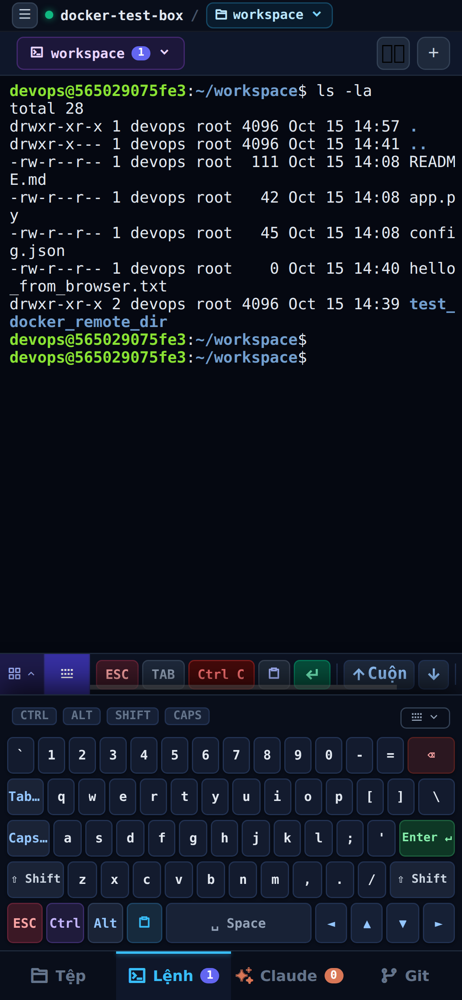
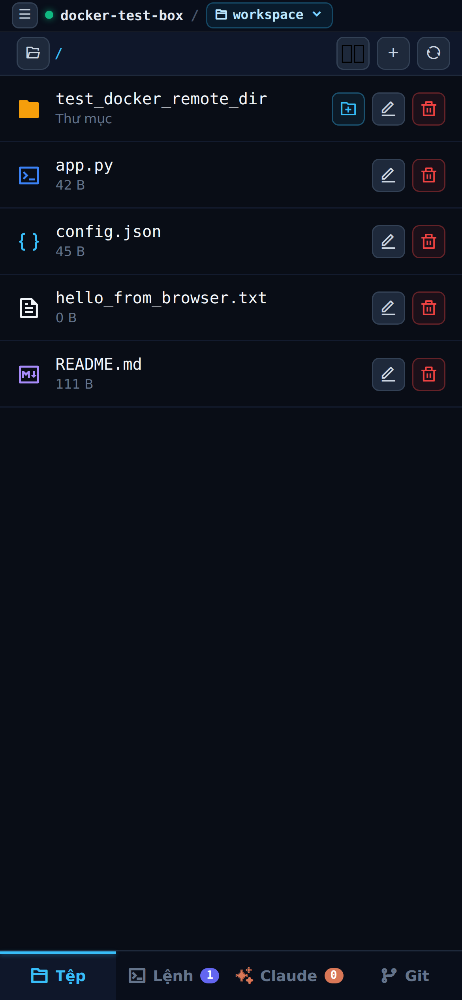
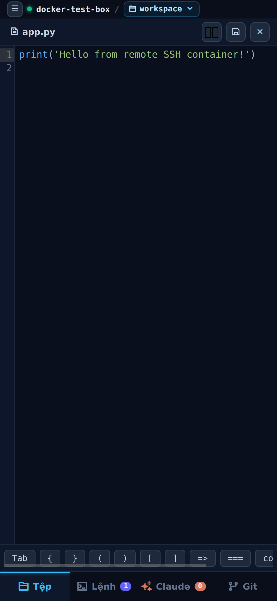

# HugRemote

**IDE trên trình duyệt cho điện thoại, tablet và desktop.** Mở terminal, duyệt và sửa file, theo dõi Git, làm việc với Claude Code trên máy hiện tại hoặc máy chủ SSH — không cần cài agent trên máy đích.

[](CHANGELOG.md) [](package.json) [](https://github.com/vibecoding-hungkc/hugremote/releases/tag/v1.6.17)

> **Bảo mật:** HugRemote có quyền truy cập terminal và file theo quyền của tài khoản đang chạy dịch vụ. Không đưa cổng HTTP ra Internet khi `AUTH_MODE=none`. Hãy bật xác thực và đặt ứng dụng sau HTTPS/reverse proxy trước khi cho phép truy cập từ xa.

## Trải nghiệm

<p align="center">
  
  
  
</p>

- **Terminal:** Nhiều phiên PTY, bàn phím ảo cho màn hình cảm ứng, phím điều hướng và tổ hợp phím thường dùng.
- **Files & Editor:** Duyệt, tải lên/xuống và sửa file trên máy hiện tại hoặc qua SSH/SFTP. Tab Files đi theo **workspace của server**, không đổi thư mục khi chuyển Project; ghi nhớ thư mục đã mở theo server và workspace. Editor hỗ trợ xem trước Markdown/HTML.
- **Git:** Xem repository và file thay đổi trong Project, trạng thái staged/unstaged và số dòng thêm/xóa. Trên mobile/tablet, chọn repository rồi vào màn chi tiết; desktop giữ bố cục hai cột.
- **Claude Code:** Chạy Claude CLI trên server, chọn model, quản lý phiên theo Project, theo dõi nội dung trả về qua stream và nối lại khi quay về trang. Có nhập liệu giọng nói tiếng Việt khi trình duyệt hỗ trợ Web Speech API.
- **Đa server:** Dùng server local, SSH và Docker/container; danh sách SSH đọc cả `Host` trong các file được `Include` từ `~/.ssh/config`.

Ảnh minh họa khác: [Terminal](docs/screenshots/mobile-terminal.png) · [Claude](docs/screenshots/mobile-claude.png) · [Server drawer](docs/screenshots/mobile-server-drawer.png). Ảnh có thể không phản ánh đúng mọi thay đổi giao diện trong phiên bản mới nhất.

## Bắt đầu

### Điều kiện

- Linux hoặc macOS; WSL có thể chạy như môi trường Linux. Node.js **18+**, npm, Git, Python 3 và bộ công cụ biên dịch native (`make` + C/C++ compiler) để cài `node-pty`.
- Quyền truy cập repository GitHub này để clone. Repository riêng tư cần xác thực GitHub; liên kết `raw.githubusercontent.com` công khai sẽ không tải được nếu bạn không có quyền truy cập.
- Để dùng Claude Code, cài và đăng nhập Claude CLI trên **chính máy chạy HugRemote** hoặc máy đích tương ứng. Để dùng SSH, cấu hình kết nối trong `~/.ssh/config` của tài khoản chạy dịch vụ.

### Cài nhanh bản web

**Stable — bản phát hành chính thức gần nhất:**

```bash
curl -fsSL https://raw.githubusercontent.com/vibecoding-hungkc/hugremote/main/install.sh | bash
```

**Beta — theo nhánh `main`:**

```bash
curl -fsSL https://raw.githubusercontent.com/vibecoding-hungkc/hugremote/main/beta.sh | bash
```

Các lệnh này **cài bản web/CLI**, không cài `.app` macOS. Hãy [đọc `install.sh`](install.sh) hoặc [đọc `beta.sh`](beta.sh) trước khi chạy, đặc biệt nếu máy đã cài HugRemote. Cần Git, Node.js, npm và công cụ biên dịch native; installer sẽ kiểm tra hoặc hướng dẫn khi thiếu. Bản Stable lấy GitHub Release mới nhất, nên thay đổi mới trên `main` chỉ có ở Beta cho tới khi phát hành bản tiếp theo. Sau khi cài, mở địa chỉ và cổng được installer thông báo.

### Chạy từ mã nguồn

```bash
git clone https://github.com/vibecoding-hungkc/hugremote.git
cd hugremote
npm ci
npm run build
npm start
```

Mở `http://localhost:8099/` trên máy chạy dịch vụ. `npm start` chạy ở foreground; dừng bằng `Ctrl+C`. Mặc định dịch vụ lắng nghe trên `::` và **không xác thực** — trước khi truy cập từ máy khác, hãy cấu hình `HOST`, `AUTH_MODE` và lớp HTTPS bảo vệ phù hợp.

Xem [các bản phát hành](https://github.com/vibecoding-hungkc/hugremote/releases) và [changelog](CHANGELOG.md). Nếu muốn quản lý toàn bộ mã nguồn, dùng cách clone và build ở trên thay vì installer.

## Ứng dụng macOS tùy chọn

HugRemote vẫn dùng qua trình duyệt và `npm start` như trước. Nếu muốn cửa sổ desktop riêng trên Mac, có thể cài qua gói `.dmg` tùy chọn (`HugRemote-macOS-arm64.dmg` hoặc `HugRemote-macOS-x64.dmg`) bằng cách mở `.dmg` và kéo `HugRemote.app` vào `Applications`; nếu macOS chặn do file tải từ trình duyệt chưa notarize bằng Apple Developer ID, chạy `xattr -cr /Applications/HugRemote.app` rồi mở lại. Electron và công cụ đóng gói **không** được cài trong luồng web mặc định. Xem [hướng dẫn cài đặt `.dmg`, build và kiểm thử](docs/macos-app.md).

## Sử dụng

```bash
hugremote --help
hugremote --version
hugremote -p 8099 -b /remote
hugremote update --dry-run
hugremote update --stable
hugremote update --beta
```

Sau `npm ci`, nếu chưa có lệnh `hugremote` trên `PATH`, thay `hugremote` bằng `node bin/hugremote.js`. Lệnh `update` theo kênh đã chọn; `--stable` lấy GitHub Release chính thức mới nhất, `--beta` theo `main`. `--dry-run` chỉ kiểm tra; `--force` yêu cầu cài lại. Bản cài đặt cô lập được lưu trong `~/.local/share/hugremote/releases/` và `current` trỏ tới bản đang hoạt động.

### Cấu hình

Tạo `~/.config/hugremote/.env` cho tài khoản chạy ứng dụng (không commit file này):

```env
PORT=8099
HOST=127.0.0.1
BASE_PATH=/remote
WORKSPACE_ROOT=/home/your-user/projects
ALLOWED_ROOT=/home/your-user
AUTH_MODE=password
APP_URL=https://example.com
```

`BASE_PATH` là đường dẫn giao diện sau reverse proxy; ví dụ trên phục vụ trang tại `/remote/`. `WORKSPACE_ROOT` là workspace mặc định của máy local, còn `ALLOWED_ROOT` giới hạn phạm vi file được phép truy cập. Các giá trị trên chỉ là mẫu: đổi đường dẫn và domain cho môi trường của bạn. Đừng đặt mật khẩu hoặc token trong câu lệnh shell hay README; nhập và lưu chúng qua kênh cấu hình an toàn, giới hạn quyền đọc file.

Chế độ xác thực: `none` (chỉ dùng trong môi trường đã được bảo vệ), `password`, hoặc `google`. Với Google OAuth, cấu hình thêm `GOOGLE_CLIENT_ID`, `GOOGLE_CLIENT_SECRET`, `GOOGLE_ALLOWED_EMAILS`; callback phụ thuộc `APP_URL` và `BASE_PATH`. Xem mã nguồn [cấu hình xác thực](apps/api/src/auth/config.ts) để kiểm tra các biến được hỗ trợ. Nếu bật Telegram sidecar, cần `TELEGRAM_BOT_TOKEN` và `TELEGRAM_ALLOWED_USERS`; **không** bật bot khi chưa giới hạn người dùng.

Trên Linux có user service, kiểm tra sau khi thay đổi cấu hình:

```bash
systemctl --user restart hugremote.service
systemctl --user status hugremote.service
```

### Kết nối SSH với `Include`

HugRemote đọc `~/.ssh/config` của **tài khoản chạy ứng dụng**, bao gồm các file được chỉ định bởi `Include`. Ví dụ không chứa thông tin kết nối thật:

```sshconfig
Include conf.d/*.conf
```

```sshconfig
# ~/.ssh/conf.d/example.conf
Host demo-server
    HostName example.invalid
    User demo
```

Vào danh sách Server để chọn host. `Host` dạng wildcard không tạo thành một server riêng. Khi thay đổi cấu hình SSH bên ngoài ứng dụng, tải lại danh sách server. Để xem giới hạn của parser và cách cập nhật host trong file include, tham khảo [config.ts](apps/api/src/config.ts).

## Phát triển và kiểm thử

```bash
npm ci
npm run build
npm run test:ui
npm run test:git
npx tsx scripts/test_ssh_config_include.ts
npx tsx scripts/test_fs_server_scope.ts
node scripts/test_file_tab_server_scope.mjs
node scripts/test_ui_git_mobile_list_details.mjs
```

`npm run build` biên dịch shared types, kiểm tra kiểu và build Vue, sau đó build Fastify API. Một số bài test tích hợp có thể tạo fixture tạm hoặc yêu cầu công cụ hệ thống; xem từng script trước khi chạy trên máy chủ sản xuất.

```text
apps/api/         Fastify API, SSH, filesystem, Git, Claude và static frontend
apps/web/         Vue 3, Vite, Pinia, giao diện responsive
packages/shared/  Kiểu dữ liệu dùng chung
bin/              CLI và isolated updater
scripts/          Kiểm thử và công cụ bảo trì
```

Tài liệu thêm: [Claude realtime streaming](docs/claude-realtime-streaming.md) · [Changelog](CHANGELOG.md) · [GitHub Releases](https://github.com/vibecoding-hungkc/hugremote/releases).
