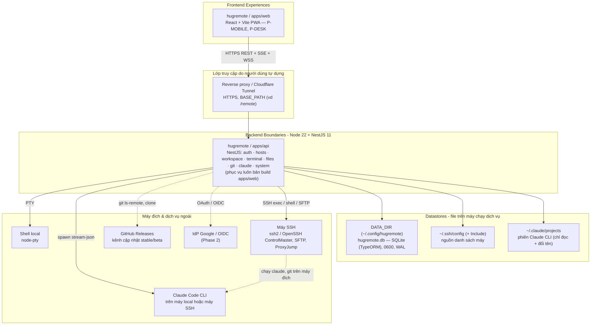

# SYSTEM ARCHITECTURE — HugRemote (bản phát triển lại)

> Kiến trúc giữ **hình dạng đã kiểm chứng của v1.x**: một tiến trình Node giữ mọi quyền đặc quyền (PTY,
> SSH, file, git, Claude CLI, auth) và phục vụ luôn SPA tĩnh; trình duyệt là phía không tin cậy.
> **Code viết lại toàn bộ** theo `stack-nestjs-react-fullstack`
> (NestJS + React/Vite, monorepo pnpm, `@app/shared`) — xem `intake/TECHSTACK.md`. Trạng thái của ứng dụng
> nằm trong **một file SQLite** (TypeORM) ở `DATA_DIR`; `~/.ssh/config` và `~/.claude/projects` là nguồn
> bên ngoài, đọc trực tiếp.
>
> Chỗ khác v1.x: tách service Claude nguyên khối (~3400 dòng) thành module; SQLite thay cho các file JSON rải ở
> `~/.ssh/` và `~/.config/`; phiên đăng nhập và danh sách phiên terminal chuyển lên server; vá các lỗ hổng
> ở §6.

## 1. Backend boundaries

_(Authority chốt 2026-11-21: một repo monorepo)_

| Boundary | Mission (1-line) | Owned data | Phase | Status |
|---|---|---|---|---|
| `hugremote` | Monorepo duy nhất của sản phẩm (`stack-nestjs-react-fullstack`): `apps/api` là tiến trình Node giữ mọi năng lực đặc quyền — xác thực, kết nối máy (local/SSH), PTY, file, git, Claude CLI — và phục vụ bản build của `apps/web` dưới `BASE_PATH` | Bảng SQLite (do `apps/api` sở hữu): `users`, `refresh_tokens`, `two_factor`, `sso_config`, `hosts_meta` (thư mục bắt đầu, loại xác thực, bí mật SSH mã hoá), `known_hosts`, `pinned_hosts`, `projects`, `terminal_sessions` (metadata), `claude_sessions`, `claude_messages`, `settings`. Ngoài DB: `~/.ssh/config` (đọc/ghi Host block), buffer PTY + tác vụ Claude trong RAM, file zip tạm | MVP | DRAFT |

> **Một target, một repo.** API và web không tách thành hai target: chúng nằm chung **một monorepo pnpm**
> tại `srcroot/boundaries/hugremote/`, đúng cấu trúc của stack skill (`§3.2`):
>
> ```text
> srcroot/boundaries/hugremote/
> ├── apps/
> │   ├── api/            # @app/api — NestJS: modules/{auth,hosts,workspace,terminal,files,git,claude,system},
> │   │                   #   health/, integrations/{ssh,pty,claude-cli,git}, infra/database (SQLite + migrations)
> │   └── web/            # @app/web — React + Vite: pages/, features/<domain>/, components/, stores/, types/api.d.ts
> ├── packages/
> │   └── shared/         # @app/shared — enum, hằng số, mã lỗi, hàm thuần dùng cả hai phía
> ├── bin/                # CLI `hugremote`, `install.sh`, `beta.sh`, updater cô lập
> ├── pnpm-workspace.yaml # apps/* + packages/*
> ├── package.json
> └── Makefile            # root Makefile của repo VIPER gọi `make -C srcroot/boundaries/hugremote …`
> ```
>
> Lý do đặt dưới `boundaries/`: `apps/api` sở hữu dữ liệu, tiến trình và cổng duy nhất; `apps/web` chỉ là
> bản build tĩnh do `apps/api` phục vụ. Ranh giới api ↔ web vẫn giữ theo bất biến của skill (§3.1): hai
> app không import nhau, chỉ nói chuyện qua HTTP/SSE/WS và cùng dùng `@app/shared`. Một tiến trình vì mọi
> năng lực dùng chung quyền của user hệ điều hành và chung pool SSH — tách service chỉ thêm IPC mà không
> thêm ranh giới bảo mật.

## 2. Frontend experiences — web

| Experience | Persona pool | Capabilities exposed | Phase | Status |
|---|---|---|---|---|
| `hugremote` | P-MOBILE, P-DESK, P-HOST, P-TEAM | Code ở `srcroot/boundaries/hugremote/apps/web` (cùng monorepo §1, **không** có thư mục riêng dưới `srcroot/web-experiences/`). SPA React + Vite, mobile-first + PWA, responsive tới desktop: đăng nhập/2FA, máy & dự án, chuyển nhanh, Terminal, Files/Editor, Git, Claude, Cài đặt. Gọi `apps/api` (không BFF) qua REST, SSE và WebSocket; type contract sinh từ OpenAPI. Prototype ở `prototype/hugremote/` | MVP | DRAFT |

- **Design system**: chưa có gói trong `intake/design-systems/` — bản cũ không khai token nào (palette
  thực tế đơn sắc tối `#161616/#282828/#3f3f3f/#eeeeee` + màu nhấn theo khu vực: sky `#38bdf8` Files/Git,
  tím `#c084fc` Terminal, đất nung `#d97757` Claude). Pha V chốt design system mới cho experience `hugremote`.

## 3. Frontend experiences — mobile

| Experience | Platform | Persona pool | Phase | Status |
|---|---|---|---|---|
| — | — | — | — | — |

> Không có mobile experience native. Trải nghiệm di động do web `hugremote` (PWA) đảm nhận — đây là
> quyết định sản phẩm từ đầu của v1. Ứng dụng macOS (CAP-OPS-05, Phase 3) là vỏ Electron
> bọc chính monorepo `hugremote` (thêm `apps/desktop` khi tới Phase 3), không phải experience riêng.

## 4. Topology



---

## 5. Cross-cutting contracts (API summary)

| Contract | Producer | Consumers (chính) | Transport | Status |
|---|---|---|---|---|
| `auth-api.v1` — `/api/auth/me`, đăng nhập mật khẩu, refresh, đổi mật khẩu, đăng xuất, vé stream ngắn hạn cho WS/SSE, 2FA (status/setup/enable/verify/disable/recovery-codes) | hugremote/apps/api | hugremote/apps/web | REST | DRAFT |
| `sso-api.v1` — `/auth/google*`, `/auth/oidc*`, cấu hình SSO (chỉ người đã đăng nhập), discover | hugremote/apps/api | hugremote/apps/web | REST + redirect | DRAFT |
| `hosts-api.v1` — liệt kê/thêm/sửa/xoá máy, thử kết nối, ngắt kết nối, danh sách khoá SSH, xác nhận host key | hugremote/apps/api | hugremote/apps/web | REST | DRAFT |
| `workspace-api.v1` — máy đã ghim, dự án (CRUD, Home, chọn), phạm vi hiện hành, tìm kiếm chuyển nhanh | hugremote/apps/api | hugremote/apps/web | REST | DRAFT |
| `terminal-api.v1` — danh sách/tạo/đổi tên/đóng phiên terminal (lưu phía server) | hugremote/apps/api | hugremote/apps/web | REST | DRAFT |
| `terminal-ws.v1` — `/ws/terminal?sessionId&cols&rows&ticket` (vé ngắn hạn từ `auth-api.v1`): client gửi phím thô + `{type:resize|ping}`, server gửi output PTY, replay buffer khi attach (sau resize), `{type:pong}`, thông báo thoát | hugremote/apps/api | hugremote/apps/web | WS | DRAFT |
| `files-api.v1` — list, read (≤10MB), save, action (tạo/đổi tên/xoá), upload multipart (giữ `relativePath`), download (thư mục → zip), quản lý file tạm | hugremote/apps/api | hugremote/apps/web | REST | DRAFT |
| `git-api.v1` — repos, status, diff, branches, checkout, pull, push, stage, unstage, commit; Phase 2: commits, commit-diff | hugremote/apps/api | hugremote/apps/web | REST | DRAFT |
| `claude-api.v1` — phiên (gộp HugRemote + CLI), tạo/đổi tên/xoá/resume, gửi tin (khởi tác vụ nền, trả ngay), hủy, trả lời tương tác, models, context-usage | hugremote/apps/api | hugremote/apps/web | REST | DRAFT |
| `claude-stream.v1` — `GET …/sessions/:id/stream?ticket` (SSE) `data:<json>` có `sequence`, reattach `?after=N` / `Last-Event-ID`, heartbeat 15s; sự kiện `sync`, `thinking_*`, `text_delta`, `content_sync`, `tool_use`, `tool_result`, `interaction_requested/responded/cancelled`, `done`, `error`, `finish` (enum trong `@app/shared`) | hugremote/apps/api | hugremote/apps/web | SSE | DRAFT |
| `system-api.v1` — `/api/health`, phiên bản, kênh; Phase 2: cập nhật + tiến độ | hugremote/apps/api | hugremote/apps/web, `hugremote doctor` | REST | DRAFT |

## 6. Ràng buộc kế thừa từ bản cũ

**Giữ nguyên — đã trả giá để học** (mỗi dòng là một lớp lỗi từng lặp lại):

| Ràng buộc | Lý do |
|---|---|
| SSH: ssh2 thử lần lượt mọi khoá không mã hoá → agent (resolve `SSH_AUTH_SOCK`, Keychain macOS) → mật khẩu; ProxyJump đổi thành chuỗi ProxyCommand `ssh -W` có `-i`; thất bại thì fallback OpenSSH hệ thống với `ControlMaster=auto` | ≥4 vòng vá ở v1.6.8–1.6.10: ProxyJump bị bỏ qua, chỉ thử khoá đầu, agent Keychain/1Password, app GUI thiếu PATH/`SSH_AUTH_SOCK` |
| Parser `~/.ssh/config` hỗ trợ `Include` (glob, đệ quy, chống vòng lặp), wildcard `Host`, giá trị đầu thắng; cache theo mtime thay vì parse lại mỗi request | v1 parse lại mỗi request; `Include` từng không được đọc |
| Đường dẫn remote lưu dạng `~/…`, không bao giờ mở rộng `~` bằng home của máy local; `cd` remote dùng nhóm lệnh `{ cd -- dir || cd "$HOME"; }` không phải subshell | v1 từng lưu `~` đã mở rộng theo home của máy local, và chạy `cd` trong subshell khiến Claude remote luôn ở `$HOME` |
| Terminal: một xterm mỗi phiên (pool, ẩn/hiện), client `fit()` trước khi mở WS, server resize PTY **trước** khi replay buffer; buffer 500KB cắt tại `\n`; debounce resize ~40ms; `LANG/LC_ALL=en_US.UTF-8` | v1 từng vỡ màn TUI (chữ chồng, bậc thang) khi chuyển phiên/đổi kích thước, cắt hỏng ký tự UTF-8 trong buffer |
| Phiên PTY: tối đa 50, thu hồi sau 30 phút không có client, LRU; nhiều socket gắn một phiên | Giới hạn đã chạy ổn ở v1 |
| ID dự án = băm SHA-256 của serverId + đường dẫn chuẩn hoá, không phụ thuộc tên hiển thị; `maxParamLength` đủ dài | v1 từng trùng ID khi hai thư mục cùng tên, rồi vỡ giới hạn độ dài tham số route (v1.6.14) |
| Claude: `claude -p --input-format stream-json --output-format stream-json --include-partial-messages --verbose`, prompt qua stdin, `--resume <cliSessionId>`, `--name`, `--permission-mode`; giải mã JSONL an toàn UTF-8; chuẩn hoá sự kiện + assembler tách khỏi transport; tác vụ chạy nền độc lập với SSE; replay buffer 1000 sự kiện | Lặp chữ, lẫn nội dung agent con, cắt UTF-8, Stop không xoá trạng thái ở v1.4–v1.6 |
| Model/effort và context usage lấy bằng control request `initialize` / `get_context_usage` trên đúng máy và đúng cwd; cache 30s; giới hạn số probe đồng thời | v1 từng đọc văn bản `/model` + danh sách cứng, lỗi thời theo phiên bản CLI |
| Enter không gửi khi đang gõ IME (Telex/VNI) — ở composer Claude và chuyển nhanh | Gõ Telex/VNI từng gửi tin sớm (v1.6.20) |
| Ghi file bị giới hạn bởi `ALLOWED_ROOT` qua `realpath` (chặn symlink, `..`, null byte, mã hoá kép) | Bộ pentest v1 đã kiểm các ca này |

**Phải sửa — lỗ hổng / nợ của v1.x:**

| Vấn đề v1.x | Yêu cầu bản mới |
|---|---|
| `/api/auth/oidc/config` và `/discover` công khai — ghi đè IdP và auth mode không cần đăng nhập; allowlist email rỗng nhận mọi email | Cấu hình SSO chỉ cho người đã đăng nhập đủ 2FA; allowlist rỗng = từ chối tất cả; kiểm chữ ký `id_token` theo JWKS |
| `GET /api/servers` trả mật khẩu SSH; mật khẩu lưu rõ trong `~/.ssh/hugcode_credentials.json` | DTO response không có trường bí mật (không trả entity — `stack-nestjs-react-fullstack §7`); bí mật SSH mã hoá trong SQLite (khoá dẫn từ secret của instance) |
| `StrictHostKeyChecking no` + `UserKnownHostsFile /dev/null` cho mọi kết nối | Tin lần đầu, lưu bảng `known_hosts`, chặn + hỏi người dùng khi host key đổi (CAP-HOST-03) |
| Phiên đăng nhập chỉ trong RAM; `SESSION_SECRET` ngẫu nhiên mỗi lần boot | JWT access token trong bộ nhớ + refresh token cookie httpOnly lưu băm trong bảng `refresh_tokens`; `JWT_SECRET` sinh và lưu lần đầu |
| Không có CSRF token; 2FA verify không giới hạn thử | Access token qua header `Authorization` (không tự gửi theo cookie) + refresh cookie `SameSite=Strict`; `@nestjs/throttler` cho đăng nhập và 2FA |
| File phiên Claude ghi 0644 dưới `~/.ssh`, ghi lại cả file mỗi tin, không khoá | Bảng `claude_sessions` + `claude_messages` trong SQLite (file 0600, WAL, transaction) — chỉ chèn tin mới, không ghi lại cả hội thoại |
| Phiên terminal chỉ trong localStorage của một trình duyệt | Metadata phiên terminal lưu phía server, đồng bộ mọi thiết bị |
| Service Claude ~3400 dòng chạy song song parser cũ và normalizer mới; còn mã mock chết | Chỉ giữ đường normalizer + assembler; tách process / probe / persistence / CLI-sessions |
| Giá trị cứng: hostname `hungpc`, đường dẫn extension code-server 2.1.292, giả định home `/home/<user>` | Bỏ; lấy `$HOME` thật của máy đích |
| Chuỗi tiếng Việt lẫn trong backend | Backend trả mã lỗi; frontend dịch |

## 7. Luồng lõi

1. **Khởi động**: `/api/auth/me` → (chưa đăng nhập: màn đăng nhập → 2FA) → tải máy đã ghim + phạm vi hiện hành từ server → khôi phục route từ hash.
2. **Terminal**: chọn dự án → mở/tạo phiên → client `fit()` → xin vé → WS `/ws/terminal?sessionId&cols&rows&ticket` → server resize PTY → attach + replay → stream hai chiều; đóng tab trình duyệt không giết PTY.
3. **Claude**: chọn dự án → chọn/tạo phiên → `POST …/sessions/:id/messages` (khởi tác vụ nền, spawn CLI trên máy đích, cwd = gốc dự án) → `GET …/sessions/:id/stream` (SSE, vé ngắn hạn) nhận sự kiện có sequence → yêu cầu quyền hiện thẻ → người dùng trả lời → `control_response` qua stdin → `done`. Mất kết nối: mở lại stream với `?after=N` / `Last-Event-ID`, server replay phần thiếu.
4. **Files/Git**: mọi request mang `serverId + projectId`; đường dẫn tương đối gốc dự án; server tự giải về đường dẫn tuyệt đối và kiểm phạm vi.
